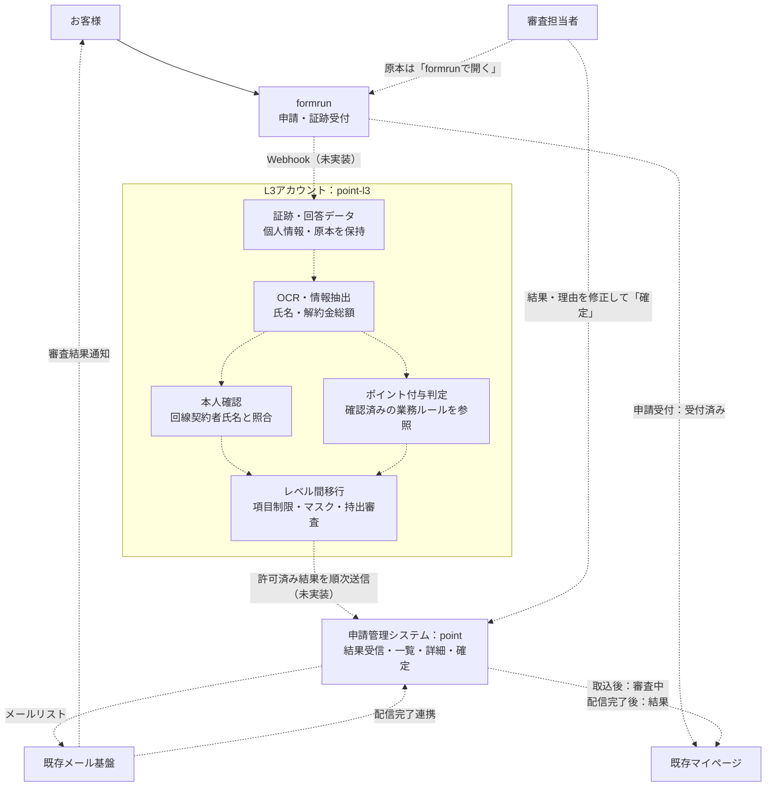
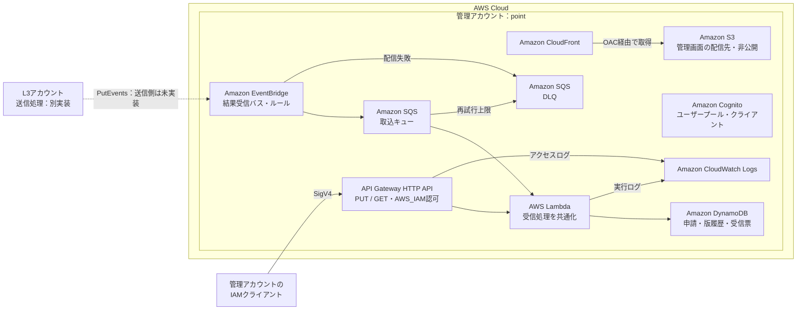
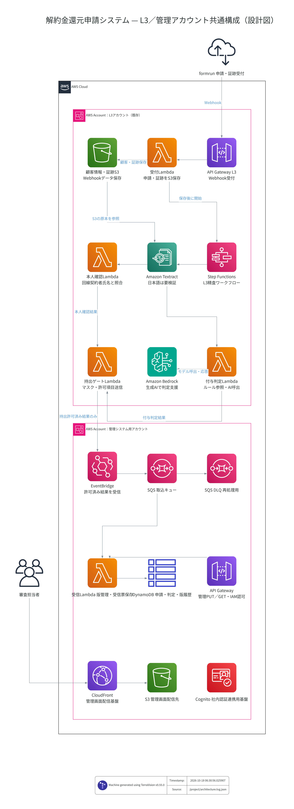

# 解約金還元申請管理システム — point

他社解約金還元申請の精査結果を受信し、担当者による確認・確定と顧客への結果通知を支える管理システム。精査工数を月約30時間削減し、7日以内に審査結果を通知することを業務目標とする。

設計の基準は「管理システム」チャットの最新の全体像・画面仕様。L3内の証跡解析・本人確認・ポイント付与判定は [point-l3](https://github.com/takuto-san/point-l3)、管理側の受信・保存・配信基盤はこのリポジトリで管理する。

## システム連携図

以下は完成時の全体像。破線は、この2リポジトリにまだ実装されていない処理・業務連携を示す。図の「申請管理システム」のうち、現在の実装は結果受信・保存まで。



本人確認とポイント付与判定は別々に実行し、それぞれの結果を順次管理側へ反映する。AIの判定出力は「結果・理由」のみ。担当者は詳細画面で内容を修正して「確定」する。管理側へ渡す比較情報は持出許可済みのマスク情報に限り、証跡原本はformrunで確認する。

| 業務イベント | マイページの表示 |
|---|---|
| formrunで申請受付 | 受付済み |
| 申請管理システムへの取込 | 審査中 |
| メール配信完了を連携 | 結果 |

メール送信可能になった時点ではなく、配信完了後に結果を公開する。画面名は「マイページ」で統一し、ポイント実付与はこの全体像に含めない。

## AWS構成図

現在のTerraformで定義している管理アカウントの構成。AWSへ適用済みの実環境を表すものではない。L3からの送信処理は別実装で、受信側のEventBridge・権限・ルールをこのリポジトリで定義している。



CloudFront/S3とCognitoは画面配信・認証の基盤のみで、管理画面コードや社内IdP連携は未実装。Cognitoと受信APIの認証連携も未実装で、現在のAPIはIAM認可を使用する。LambdaはVPCに接続しない最小サーバーレス構成のため、VPC・サブネット・NATは作成しない。

<details>
<summary>TerraformからTerravisionで生成した詳細構成図</summary>



[SVG版](docs/architecture-aws.dot.svg)。Terraform planに基づくリソース依存関係の図で、業務処理の順序は上のシステム連携図を参照。

</details>

## ディレクトリ構成

```text
point/
├── README.md
├── Dockerfile                         # Swagger UI
├── docker-compose.yml                 # localhost:8080
├── .dockerignore
├── .gitignore
├── openapi/
│   └── l3-management.openapi.yaml      # 管理側受信API・共通データ契約の正本
├── terraform/
│   ├── versions.tf                    # Terraform・プロバイダのバージョン
│   ├── providers.tf                   # 管理アカウントへの接続
│   ├── variables.tf                   # 入力変数
│   ├── locals.tf                      # 共通名・タグ
│   ├── management.tf                  # EventBridge・SQS・DB・画面配信・認証基盤
│   ├── api.tf                         # IAM認可の受信・受信票API
│   ├── lambda.tf                      # 受信Lambda・IAM・イベントソース
│   ├── outputs.tf                     # API URL・EventBridge ARN等
│   ├── terraform.tfvars.example        # 設定例
│   ├── .terraform.lock.hcl             # プロバイダの固定
│   ├── .gitignore                      # ローカル設定・生成物を除外
│   ├── README.md                       # 適用・受信処理の詳細
│   └── lambda/
│       ├── index.mjs                  # HTTP / SQSのエントリポイント
│       ├── schema.mjs                 # OpenAPIスキーマ検証・正規化
│       └── store.mjs                  # 版管理・受信票・トランザクション
├── tests/
│   └── receiver.test.mjs              # 再送・競合・確定後保留のテスト
├── tools/
│   ├── diagram.sh                     # Terravision構成図の再生成
│   └── diagram-providers.tf.txt        # 図生成専用の仮プロバイダ設定
└── docs/
    ├── architecture-aws.dot.png
    └── architecture-aws.dot.svg
```

生成物・ローカル設定の `.terraform/`、state、zip、`terraform.tfvars` はGit管理対象外。

## 実装状況

| 項目 | 現在の状態 |
|---|---|
| EventBridge → SQS → Lambda → DynamoDB | 定義・受信コードあり |
| 受信APIのPUT / 受信票照会GET | 定義・受信コードあり。IAM認可 |
| 同一revisionの再送・競合、旧版、確定後の保留 | 共通保存処理とテストあり |
| CloudFront・非公開S3・Cognito | Terraform定義あり。画面・認証連携は未実装 |
| 一覧・詳細画面、結果・理由の編集、「確定」API | 未実装 |
| メールリスト、配信完了受付、マイページ連携 | 未実装 |
| formrun Webhook、OCR、AI判定、持出審査・送信 | point-l3側の担当範囲。未実装 |

計画している管理画面は「申請一覧」「申請詳細」の2画面。一覧は `申請ID → NIFTY ID → 受付日 → 本人確認 → 審査 → 通知 → 不備理由 → 解約金 → 詳細` の順に表示する。詳細はマスク済みの回線契約情報と証跡抽出情報を並べ、その下に「formrunで開く」、編集可能な「判定結果（結果・理由）」と「確定」を置く。独立した最終判定欄やメモ欄は追加しない。

## ローカル起動・検証

Swagger UIは仕様閲覧用で、管理画面や受信API本体のローカル起動ではない。

```bash
docker compose up --build -d
# http://localhost:8080

node --test tests/*.test.mjs
terraform -chdir=terraform init
terraform -chdir=terraform validate
```

Terraformの適用手順と受信処理の詳細は [terraform/README.md](terraform/README.md) を参照。

## L3との接続

1. 管理側の `terraform/terraform.tfvars.example` を元に実環境設定を用意し、管理インフラを適用する。
2. 出力 `management_event_bus_arn` を取得し、point-l3の同名変数へ設定する。
3. 両リポジトリの `l3_account_id` を同じL3アカウントIDに揃える。

```bash
terraform -chdir=terraform output -raw management_event_bus_arn
```

通常の結果連携はEventBridge。イベントの `source` は `jp.co.nifty.point-award.l3`、`detail-type` は `AnalysisSnapshot.v1`、`detail` はOpenAPIの `AnalysisSnapshot` とする。HTTPSのPUT/GETは管理アカウント内の照会・検証用で、L3からの直接クロスアカウントHTTPS呼び出し権限は付与していない。

OpenAPIの正本は [openapi/l3-management.openapi.yaml](openapi/l3-management.openapi.yaml)。point-l3のコピーは契約更新時に同じ内容へ更新する。両側のTerraform stateは独立して管理する。

## AWS構成図の再生成

```bash
bash tools/diagram.sh
```

TerraformとDockerが必要。図生成専用の一時コピーと仮のアカウントIDでplanを作成し、TerravisionでPNG/SVGを生成する。AWS API・実stateを参照せず、AWSへの適用も行わない。
