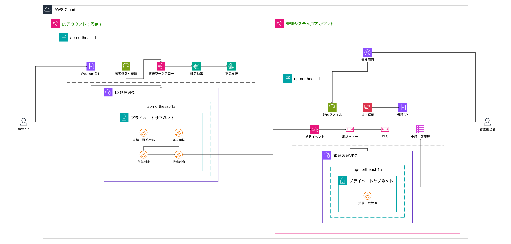

# 解約金還元申請管理システム

## 概要

他社解約金還元申請の精査結果を受信し、担当者による確認・確定と顧客への結果通知を支える管理システム。L3環境で証跡解析・本人確認・ポイント付与判定を行い、許可された結果だけを管理システムへ連携する。


## 1. 依存関係

| 名前 | バージョン |
|---|---|
| Docker / Docker Compose | Compose v2 |
| Terraform | 1.6.0以上 |
| AWS CLI | v2 |
| Swagger UI | 5.33.1 |
| Diagram-as-Code (`awsdac`) | v0.23 |

## 2. セットアップ

```bash
git clone https://github.com/takuto-san/point.git
cd point
docker compose up --build -d --wait
docker compose ps
cp terraform/environments/dev.tfvars.example terraform/environments/dev.tfvars
terraform -chdir=terraform init
terraform -chdir=terraform fmt -check -recursive
terraform -chdir=terraform validate
terraform -chdir=terraform plan -var-file=environments/dev.tfvars
awsdac aws-architecture.yml --output diagrams/aws-architecture.png --force
```

Swagger UI は <http://localhost:8080> で確認できる。ポートを変更する場合は、例えば
`SWAGGER_PORT=18080 docker compose up --build -d --wait` とする。終了時は
`docker compose down` を実行する。

### Docker構成の選定

- OpenAPI定義の閲覧用途に限定し、独自のWebサーバーは実装せず公式Swagger UIイメージを使用する。
- 再現性のため`latest`を避け、OpenAPI 3.1対応のSwagger UI 5.33.1へ固定する。
- 定義ファイルをイメージへ含め、同じイメージをローカル確認と配布の両方に使用できるようにする。
- 公開先をループバックアドレスに限定し、コンテナ内の権限昇格を抑止する。

## 3. ディレクトリ構成

```text
point/
├── README.md
├── aws-architecture.yml
├── openapi.yml
├── Dockerfile
├── docker-compose.yml
├── terraform/
│   ├── README.md
│   ├── *.tf                    # 環境設定を担うルートモジュール
│   ├── environments/           # 環境別tfvarsサンプル
│   └── modules/
│       └── management-platform/ # AWSリソース実装
└── diagrams/
    ├── aws-architecture.png
    └── system-overview.png
```

## 4. AWS構成図



この図は目標構成です。L3側は単一AZ・単一プライベートサブネットに処理Lambdaを集約します。VPC・AZ・サブネットとLambdaのVPC接続は現時点のTerraformには未実装です。
