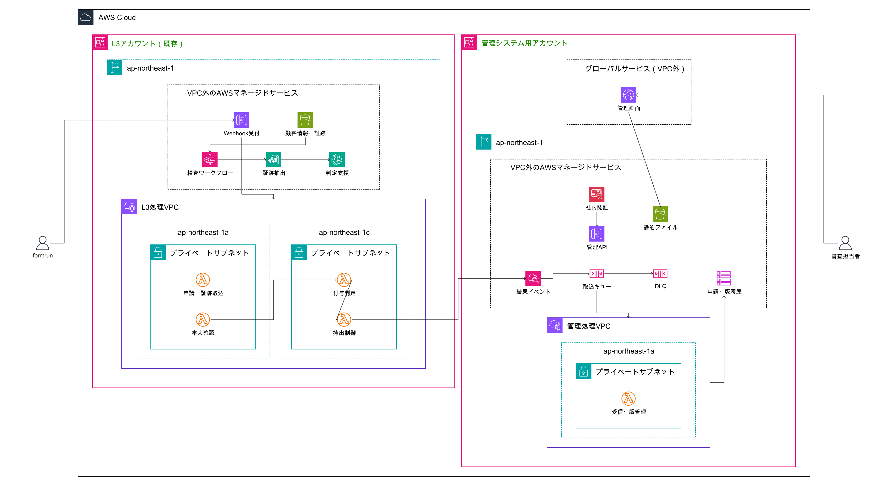

# Terraform

## 構成図



## ディレクトリ構成

```text
terraform/
├── README.md
├── aws-architecture.yaml
├── main.tf
├── api.tf
├── lambda.tf
├── variables.tf
├── outputs.tf
├── locals.tf
├── providers.tf
├── versions.tf
├── terraform.tfvars.example
├── .terraform.lock.hcl
└── files/
    └── lambda/
        ├── index.mjs
        ├── schema.mjs
        └── store.mjs
```
